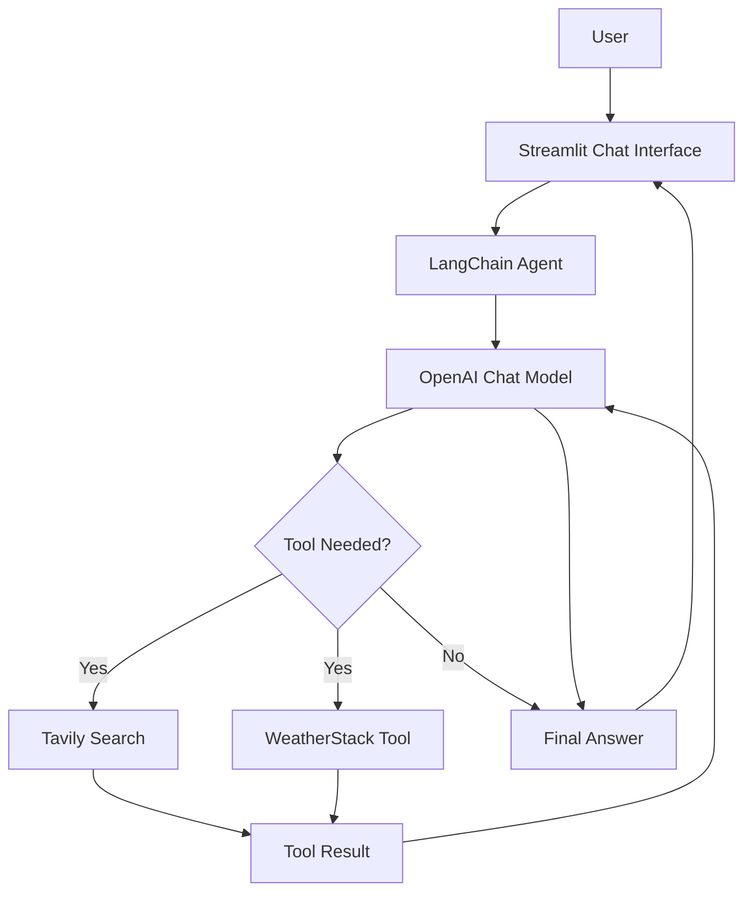

# LangChain Single Agent — AI Engineering Learning Project

A hands-on AI Engineering project for learning how to build, debug, stream, and deploy a tool-using AI agent with LangChain, OpenAI, Tavily, WeatherStack, and Streamlit.

This project starts with a Python-based AI agent and gradually extends it into an interactive web application that can search the web, retrieve current weather information, and display agent execution steps.

> **Project type:** Learning / Educational  
> **Primary language:** Python  
> **Framework:** LangChain 1.x  
> **Web interface:** Streamlit  
> **Deployment platform:** Render

---

## Table of Contents

- [Project Overview](#project-overview)
- [Learning Objectives](#learning-objectives)
- [Features](#features)
- [Technology Stack](#technology-stack)
- [Architecture](#architecture)
- [Project Structure](#project-structure)
- [Prerequisites](#prerequisites)
- [API Keys](#api-keys)
- [Installation](#installation)
- [Environment Configuration](#environment-configuration)
- [Running the Project](#running-the-project)
- [How the Agent Works](#how-the-agent-works)
- [Understanding the Main Components](#understanding-the-main-components)
- [Streaming and Agent Execution Logs](#streaming-and-agent-execution-logs)
- [Streamlit Web Application](#streamlit-web-application)
- [Deployment on Render](#deployment-on-render)
- [Troubleshooting](#troubleshooting)
- [Security Considerations](#security-considerations)
- [Current Limitations](#current-limitations)
- [Learning Roadmap](#learning-roadmap)
- [Useful Resources](#useful-resources)
- [License](#license)

---

## Project Overview

The goal of this project is to understand how an AI agent can interact with external tools instead of relying exclusively on its language model.

A normal language model generates responses based on its learned knowledge and the context provided to it. An agent can additionally decide when to call an available tool, receive the tool's result, and use that result to formulate its answer.

This project implements a single AI agent with two tools:

1. **Tavily Web Search:** Retrieves relevant information from the web.
2. **WeatherStack:** Retrieves current weather information for a specified location.

The agent uses an OpenAI chat model through LangChain. A Streamlit application provides a browser-based interface, and Render can host the application online.

### Example questions

- "Give me the latest news about PHP vulnerabilities."
- "What is the current weather in Dhaka, Bangladesh?"
- "Search for the latest developments in AI agents."
- "Find recent security advisories related to Python."

The agent decides whether to use a tool based on the question, the tools available to it, and its instructions.

Search results and weather information depend on the external services, their API access, and their response quality.

---

## Learning Objectives

This project is designed to help learners understand the following concepts.

### 1. Python Environment Management

- Creating and managing a Python project.
- Using `uv` to manage dependencies and virtual environments.
- Understanding `pyproject.toml` and `uv.lock`.
- Managing environment variables with `.env` and `python-dotenv`.

### 2. LangChain Fundamentals

- Connecting to an OpenAI chat model.
- Understanding the `ChatOpenAI` integration.
- Creating custom tools with the `@tool` decorator.
- Registering multiple tools with an agent.
- Using `create_agent()` from LangChain 1.x.
- Understanding messages, tool calls, and tool results.

### 3. AI Agent Execution

- Understanding the difference between a normal LLM call and an agent.
- Learning how an agent decides to call tools.
- Observing tool inputs and outputs.
- Understanding the model–tool–model execution cycle.
- Distinguishing visible execution logs from private model reasoning.

### 4. Streaming

- Understanding token-by-token output.
- Using LangGraph streaming modes.
- Observing graph updates.
- Displaying tool calls and tool results during execution.

### 5. API Integration

- Making HTTP requests with `requests`.
- Passing query parameters to an external API.
- Handling timeouts and request failures.
- Reading JSON responses.
- Understanding API keys and SSL certificate verification.

### 6. Building a Web Interface

- Creating a chat interface with Streamlit.
- Using `st.chat_input()` and `st.chat_message()`.
- Managing chat history with `st.session_state`.
- Displaying streaming responses.
- Showing tool execution logs in the UI.

### 7. Deployment

- Preparing a Python application for deployment.
- Using Git and GitHub.
- Configuring a Render Web Service.
- Managing deployment secrets.
- Understanding build commands, start commands, and deployment logs.

---

## Features

### AI Chat Agent

The application accepts natural-language questions and uses an OpenAI chat model to generate responses.

### Web Search

The Tavily integration enables the agent to retrieve relevant web-search results when current or external information is needed.

### Current Weather

A custom WeatherStack tool retrieves weather data for a requested city or location.

The tool currently returns information such as:

- Location
- Temperature in Celsius
- Weather description

Additional fields, such as humidity, can be added to the tool.

### Tool Execution Logs

The agent can display visible execution information, including:

- Tool name
- Tool input
- Tool output
- Final assistant response

These logs help learners understand how the agent interacts with external tools.

### Streaming Responses

The application can stream model-generated text instead of waiting for the complete response.

### Browser-Based Interface

Streamlit provides an interactive web interface without requiring a separate frontend framework.

### Cloud Deployment

The application can be deployed to Render and accessed through a hosted URL.

---

## Technology Stack

| Technology         | Purpose                                      |
| ------------------ | -------------------------------------------- |
| Python             | Main programming language                    |
| `uv`               | Python dependency and environment management |
| LangChain          | Agent creation and tool integration          |
| LangGraph          | Agent execution and streaming infrastructure |
| `langchain-openai` | OpenAI model integration                     |
| OpenAI API         | Language model inference                     |
| `langchain-tavily` | Tavily search integration                    |
| Tavily             | Web search                                   |
| WeatherStack       | Current weather data                         |
| `requests`         | HTTP requests                                |
| `python-dotenv`    | Loading environment variables                |
| `certifi`          | CA certificate bundle                        |
| Streamlit          | Web application interface                    |
| Git and GitHub     | Version control and source hosting           |
| Render             | Cloud deployment                             |

The exact package versions are determined by the project's `pyproject.toml` and `uv.lock`.

---

## Architecture

The application follows a simple agent architecture.



### Execution flow

1. The user submits a question through Streamlit.
2. The application sends the question to the LangChain agent.
3. The agent invokes the configured language model.
4. The model may request a tool call.
5. LangChain executes the selected tool.
6. The tool result is returned to the agent.
7. The model uses the result to produce an answer.
8. Streamlit displays the response and available execution logs.

A question does not necessarily require a tool call. The agent may answer directly when appropriate.

---

## Project Structure

The recommended project layout is:

```text
langchain-single-agent/
│
├── main.py
├── app.py
├── pyproject.toml
├── uv.lock
├── render.yaml
├── README.md
├── .gitignore
└── .env
```

### File descriptions

**`main.py`**

Contains the agent configuration, API setup, custom weather tool, Tavily search tool, and the function for running the agent.

**`app.py`**

Contains the Streamlit interface, chat history, streaming logic, and execution-log display.

**`pyproject.toml`**

Defines the Python project metadata and direct dependencies.

**`uv.lock`**

Locks the resolved dependency versions for more reproducible installations.

**`render.yaml`**

Defines the Render service configuration, including the build and start commands.

**`.env`**

Stores local development secrets. This file must not be committed to Git.

**`.gitignore`**

Specifies files and directories that Git should ignore.

---

## Prerequisites

Before running this project, make sure you have:

- Python installed in a version compatible with your dependencies and deployment environment.
- `uv` installed.
- Git installed.
- An OpenAI API key.
- A Tavily API key.
- A WeatherStack API key.
- A code editor such as Visual Studio Code.

Useful installation resources:

- Python: https://www.python.org/downloads/
- uv: https://docs.astral.sh/uv/
- Git: https://git-scm.com/downloads/
- Visual Studio Code: https://code.visualstudio.com/

Check your installations:

```powershell
python --version
uv --version
git --version
```

If you are using a project that declares `requires-python = ">=3.14"`, ensure your local and deployment Python versions satisfy that requirement and that all dependencies support the selected version.

---

## API Keys

This project uses three external API credentials.

### OpenAI API Key

Used by the language model.

Get started at:

https://platform.openai.com/

### Tavily API Key

Used by the web-search tool.

Get started at:

https://tavily.com/

### WeatherStack API Key

Used by the custom weather tool.

Get started at:

https://weatherstack.com/

The availability, pricing, usage limits, and access requirements of these services may change. Check each provider's current documentation and account dashboard.

---

## Installation

### Step 1: Open the project directory

In Windows PowerShell:

```powershell
cd "C:\webDevelopment\ai-engineering\agentic-ai\langchain-single-agent"
```

Adjust the path if your project is stored elsewhere.

### Step 2: Install dependencies

Install the required packages with `uv`:

```powershell
uv add langchain langchain-openai langchain-tavily python-dotenv certifi requests streamlit
```

If these dependencies are already declared in `pyproject.toml`, you can simply run:

```powershell
uv sync
```

### Step 3: Verify the dependencies

```powershell
uv run python -c "import langchain, langchain_openai, langchain_tavily, streamlit; print('Dependencies imported successfully')"
```

### Step 4: Generate or update the lock file

```powershell
uv lock
```

Commit both `pyproject.toml` and `uv.lock` to Git.

---

## Environment Configuration

Create a `.env` file in the project root.

```dotenv
OPENAI_API_KEY=your_openai_api_key
TAVILY_API_KEY=your_tavily_api_key
WEATHERSTACK_API_KEY=your_weatherstack_api_key
```

Replace the example values with your actual API keys.

Do not put quotation marks around values unless they are part of the intended secret.

### Loading environment variables

The project uses `python-dotenv`:

```python
import os
from dotenv import load_dotenv

load_dotenv()

OPENAI_API_KEY = os.getenv("OPENAI_API_KEY")
TAVILY_API_KEY = os.getenv("TAVILY_API_KEY")
WEATHERSTACK_API_KEY = os.getenv("WEATHERSTACK_API_KEY")
```

### Validating configuration

Check required variables at application startup:

```python
if not OPENAI_API_KEY:
    raise ValueError("OPENAI_API_KEY is not configured")

if not TAVILY_API_KEY:
    raise ValueError("TAVILY_API_KEY is not configured")

if not WEATHERSTACK_API_KEY:
    raise ValueError("WEATHERSTACK_API_KEY is not configured")
```

Never print or expose the actual API key values.

---

## Running the Project

### Run the Python agent

If `main.py` includes a command-line entry point, execute:

```powershell
uv run python main.py
```

For example, the entry point can call:

```python
if __name__ == "__main__":
    run_agent(
        "Give me the current weather in Dhaka, Bangladesh"
    )
```

Keeping test execution inside the `if __name__ == "__main__":` block prevents it from running automatically when another module imports `main.py`.

### Run the Streamlit application

Start the web application with:

```powershell
uv run streamlit run app.py
```

Streamlit usually opens the local application at:

http://localhost:8501

If the browser does not open automatically, visit that address manually.

Stop the development server with `Ctrl+C` in the terminal.

---

## How the Agent Works

The agent is created with LangChain's `create_agent()` API.

A simplified example:

```python
from langchain.agents import create_agent

agent = create_agent(
    model=llm,
    tools=tools,
    system_prompt=SYSTEM_PROMPT,
)
```

### Model

The model is initialized through `ChatOpenAI`.

For example:

```python
from langchain_openai import ChatOpenAI

llm = ChatOpenAI(
    model="gpt-4o",
    temperature=0,
    api_key=OPENAI_API_KEY,
    max_retries=3,
    timeout=30,
    max_tokens=200,
)
```

The selected model must be available to your OpenAI API account. Model names and supported parameters can change; consult the current integration documentation if you encounter an unsupported-parameter error.

### Tools

The agent receives a list of tools:

```python
tools = [
    search_tool,
    get_weather_data,
]
```

Each tool has a name, description, and input schema. The model uses these details to decide when a tool is appropriate.

### System prompt

The system prompt gives the agent instructions about its role and tool usage.

For example:

```python
SYSTEM_PROMPT = """
You are a helpful AI assistant with web search
and weather tools.

Instructions:
- Use web search for current information.
- Use the weather tool when current weather is requested.
- Do not invent search results or weather information.
- Explain when a tool fails.
- Answer in the user's language whenever possible.
"""
```

In LangChain 1.x, this kind of instruction is appropriate for `create_agent()`.

An older ReAct prompt containing placeholders such as `{tools}`, `{tool_names}`, `{input}`, and `{agent_scratchpad}` should not simply be passed as a `create_agent()` system prompt. Those placeholders belong to older prompt templates and agent construction patterns.

---

## Understanding the Tools

### Tavily Search

The Tavily integration can be initialized as follows:

```python
from langchain_tavily import TavilySearch

search_tool = TavilySearch(
    max_results=2,
    tavily_api_key=TAVILY_API_KEY,
)
```

The tool can retrieve relevant web-search results when the agent calls it.

The `max_results` setting limits the number of search results requested by this configuration. It does not guarantee that every result is accurate or that the information is exhaustive.

### WeatherStack Custom Tool

The weather tool uses the `@tool` decorator:

```python
from langchain.tools import tool
import requests


@tool
def get_weather_data(location: str) -> str:
    """Get the current weather for a given location."""

    url = "https://api.weatherstack.com/current"

    params = {
        "access_key": WEATHERSTACK_API_KEY,
        "query": location,
    }

    try:
        response = requests.get(
            url,
            params=params,
            timeout=15,
        )
        response.raise_for_status()
        data = response.json()

    except (requests.RequestException, ValueError) as exc:
        return f"Could not retrieve weather data: {exc}"

    if "current" not in data:
        error = data.get("error", {}).get(
            "info",
            "Unknown API error",
        )
        return f"Weather lookup failed: {error}"

    current = data["current"]
    descriptions = current.get(
        "weather_descriptions",
        ["Unknown"],
    )

    location_data = data.get("location", {})

    return (
        f"Location: {location_data.get('name', location)}\n"
        f"Temperature: {current.get('temperature', 'N/A')}°C\n"
        f"Weather: {descriptions[0]}\n"
        f"Humidity: {current.get('humidity', 'N/A')}%"
    )
```

This example demonstrates several useful programming concepts:

- Defining a tool with a typed argument.
- Calling an HTTP API.
- Passing query parameters separately from the URL.
- Setting a timeout.
- Handling HTTP and JSON errors.
- Validating the response before reading its fields.
- Returning a string that the agent can interpret.

The example illustrates the intended tool behavior. Keep the implementation in `main.py` consistent with the actual code in your repository.

---

## Streaming and Agent Execution Logs

LangChain agents use LangGraph execution infrastructure. Streaming can be used to inspect model output and execution updates.

### Token streaming

```python
for token, metadata in agent.stream(
    inputs,
    stream_mode="messages",
):
    ...
```

The `messages` mode provides model message chunks and metadata. Text chunks can be rendered incrementally in a terminal or a Streamlit container.

### Execution updates

```python
for chunk in agent.stream(
    inputs,
    stream_mode="updates",
):
    ...
```

The `updates` mode exposes agent state updates. These can include model messages containing tool calls and tool messages containing tool results.

### Combining both modes

```python
for mode, chunk in agent.stream(
    inputs,
    stream_mode=["messages", "updates"],
):
    if mode == "messages":
        token, metadata = chunk
        # Process model message chunks.

    elif mode == "updates":
        # Process agent state updates.
        ...
```

The exact content of a streamed chunk depends on the mode, node, and message type. Code should inspect the returned structures rather than assuming every message contains `tool_calls`.

### Understanding the execution terminology

| Term         | Meaning                                      |
| ------------ | -------------------------------------------- |
| Action       | A requested tool invocation                  |
| Action Input | The arguments supplied to a tool             |
| Observation  | The result returned by a tool                |
| Final Answer | The user-facing answer produced by the model |
| Stream chunk | A partial message or state update            |
| Node update  | An update emitted by a graph node            |

These are useful ReAct-style learning labels. The current implementation does not reproduce every line of the legacy `AgentExecutor(verbose=True)` output.

Private chain-of-thought is not required to understand tool execution. Focus on visible tool calls, their inputs, returned results, and the final response.

---

## Streamlit Web Application

Streamlit provides the browser-based interface.

### Chat interface

The application uses:

```python
st.chat_input()
st.chat_message()
```

These components provide a user input area and separate chat messages.

### Session state

```python
if "messages" not in st.session_state:
    st.session_state.messages = []
```

Streamlit reruns the script when users interact with the application. Session state allows chat messages to persist across those reruns within the current session.

This is not the same as persistent database storage. A production application that needs durable conversations should use a suitable database and an appropriate user/session model.

### Streaming output

A placeholder can be updated while chunks arrive:

```python
response_placeholder = st.empty()

response_text = ""

response_text += new_text_chunk

response_placeholder.markdown(
    response_text + "▌"
)
```

The cursor character indicates that the response is still being generated. After streaming completes, render the final text without the cursor.

### Tool execution display

The application can use `st.expander()` to display execution logs without making them permanently occupy the main chat area.

For example:

```python
with st.expander("Agent Actions & Observations"):
    st.write("Tool execution details appear here.")
```

Do not display secrets or sensitive internal information in these logs.

---

## Deployment on Render

Render can host the Streamlit application as a Web Service.

### Recommended deployment flow

1. Test the application locally.
2. Commit the project to Git.
3. Push the repository to GitHub.
4. Add a `render.yaml` file.
5. Create a Render Blueprint or Web Service.
6. Configure API keys in the Render dashboard.
7. Deploy the application.
8. Review build and runtime logs.
9. Test the deployed application.

Official resources:

- Render Dashboard: https://dashboard.render.com/
- Render deployment guide: https://render.com/docs/your-first-deploy
- Environment variables: https://render.com/docs/configure-environment-variables

### Example `render.yaml`

```yaml
services:
    - type: web
      name: langchain-single-agent
      runtime: python
      plan: free

      buildCommand: pip install uv && uv sync --frozen

      startCommand: uv run --no-sync streamlit run app.py --server.address 0.0.0.0 --server.port $PORT --server.headless true

      envVars:
          - key: OPENAI_API_KEY
            sync: false

          - key: TAVILY_API_KEY
            sync: false

          - key: WEATHERSTACK_API_KEY
            sync: false
```

This is a starting configuration, not a guarantee of a successful deployment. Confirm that your Render service supports the selected plan, runtime, and commands.

The `uv.lock` file must be committed if the build uses `uv sync --frozen`.

### Environment variables on Render

Configure these variables in the Render dashboard:

- `OPENAI_API_KEY`
- `TAVILY_API_KEY`
- `WEATHERSTACK_API_KEY`

Do not commit actual API keys to GitHub or place them directly in `render.yaml`.

### Port binding

The Streamlit server must listen on `0.0.0.0` and the port supplied by Render. The example start command configures both.

### Python compatibility

The Python version required by `pyproject.toml` must be compatible with the selected Render runtime and all installed dependencies.

If the project declares `requires-python = ">=3.14"`, verify that the deployment environment supports that requirement. A dependency lock file does not override an incompatible Python runtime.

### Deployment costs

Hosting charges, free-tier availability, resource limits, and third-party API costs depend on the current provider plans and usage. Check the relevant dashboards before deploying a public application.

---

## Troubleshooting

### 1. `OPENAI_API_KEY is not configured`

**Possible causes:**

- The `.env` file is missing.
- The variable name is incorrect.
- The key is not configured in Render.
- The application is being launched from an unexpected working directory.

**Suggested checks:**

- Confirm the `.env` file is in the project root.
- Confirm that `load_dotenv()` executes before reading the variables.
- Configure the variables in Render's environment settings.

Do not print the actual key to debug this problem.

### 2. `TAVILY_API_KEY` or search errors

**Possible causes:**

- Invalid API key.
- API quota or account restrictions.
- Network problems.
- Changes to the integration API.

Check the Tavily dashboard and the installed `langchain-tavily` documentation.

### 3. Weather data cannot be retrieved

**Possible causes:**

- Invalid WeatherStack credentials.
- Unsupported location input.
- API quota or service restrictions.
- HTTP request timeout.
- Unexpected API response.

Use HTTPS, set a reasonable timeout, and inspect sanitized error information.

### 4. `NameError: name 'agent' is not defined`

**Possible causes:**

- The agent creation code has not executed.
- The variable is defined in a different module or scope.
- An import failed before the agent was created.

Confirm that `agent = create_agent(...)` executes successfully before invoking `agent.stream()`.

### 5. `AttributeError: 'ToolMessage' object has no attribute 'tool_calls'`

Not every message represents a model tool-call request. Tool results are commonly represented as `ToolMessage` objects.

Use safe access:

```python
tool_calls = getattr(message, "tool_calls", [])
```

Check the message type before interpreting it as a tool call or tool result.

### 6. Streamlit cannot import `agent`

Check that:

- `main.py` is in the same project directory as `app.py`.
- The import statement matches the filename.
- Agent initialization does not fail because of missing environment variables.
- Test execution is protected by `if __name__ == "__main__":`.

### 7. Render build fails

Check:

- `pyproject.toml` is committed.
- `uv.lock` is committed.
- The Python runtime satisfies `requires-python`.
- All required packages are declared.
- The build command completes successfully.

### 8. Render application fails to start

Check the runtime logs for:

- Missing environment variables.
- Import errors.
- Unsupported package versions.
- Incorrect start commands.
- Port configuration problems.

### 9. The application returns no streamed text

A tool may be executing, the model may return non-text content, or the application may be filtering chunks incorrectly.

Inspect the stream mode and metadata. Do not assume that every chunk contains text or that every message belongs to the model node.

---

## Security Considerations

This is a learning project, but it is important to practice safe development from the beginning.

- Never commit `.env` to Git.
- Never expose API keys in the frontend.
- Store deployment secrets in Render environment variables.
- Set timeouts on external HTTP requests.
- Handle API errors without leaking credentials.
- Avoid displaying sensitive data in execution logs.
- Review dependency versions and security advisories.
- Add rate limiting and authentication before exposing a costly agent publicly.
- Consider request quotas and maximum input sizes.
- Treat web-search results as untrusted external content.
- Do not allow tool outputs to override the application's trusted instructions.

A public URL may allow anyone to consume your API quota if access is unrestricted. Add suitable protections before using the application as a public service.

---

## Current Limitations

This project is intentionally small and educational.

### No persistent database

Conversation history is maintained in Streamlit session state rather than a database.

### No authentication

The initial version does not implement user accounts or access control.

### Limited tool set

Only web search and current weather retrieval are included.

### No formal evaluation pipeline

The project does not yet include automated agent-quality evaluation, regression tests, or systematic tool-call accuracy measurements.

### No production observability

Execution logs are useful for learning, but they do not replace structured logging, monitoring, tracing, and error reporting.

### External service dependencies

The application depends on the availability, quotas, and behavior of OpenAI, Tavily, WeatherStack, and Render.

These limitations provide opportunities for future improvements.

---

## Learning Roadmap

A recommended progression for this project is:

### Stage 1: Python and Environment Setup

- [ ] Understand `pyproject.toml`.
- [ ] Learn `uv add`, `uv sync`, and `uv run`.
- [ ] Understand environment variables and `.env`.
- [ ] Practice Python functions, decorators, exceptions, and HTTP requests.

### Stage 2: LangChain Fundamentals

- [ ] Understand `ChatOpenAI`.
- [ ] Learn how `@tool` works.
- [ ] Understand tool names, descriptions, and input schemas.
- [ ] Build a simple model call.
- [ ] Build a tool-using agent with `create_agent()`.

### Stage 3: Agent Execution

- [ ] Inspect model messages.
- [ ] Identify tool-call requests.
- [ ] Inspect tool results.
- [ ] Understand the agent loop.
- [ ] Compare the current API with older ReAct agent examples.

### Stage 4: Streaming

- [ ] Use `stream_mode="messages"`.
- [ ] Use `stream_mode="updates"`.
- [ ] Combine multiple stream modes.
- [ ] Stream text into a Streamlit placeholder.
- [ ] Display action and observation logs.

### Stage 5: Web Application

- [ ] Build the Streamlit chat interface.
- [ ] Understand session state.
- [ ] Add chat history.
- [ ] Improve error handling.
- [ ] Add a configurable model selector.
- [ ] Separate agent logic from the interface.

### Stage 6: Deployment

- [ ] Create a GitHub repository.
- [ ] Configure `.gitignore`.
- [ ] Add `render.yaml`.
- [ ] Deploy to Render.
- [ ] Configure environment variables.
- [ ] Test the public deployment.
- [ ] Review logs and usage costs.

### Stage 7: Advanced Improvements

- [ ] Add persistent conversation storage.
- [ ] Add automated tests.
- [ ] Add structured logging.
- [ ] Implement authentication and rate limiting.
- [ ] Explore LangGraph state and conditional execution.
- [ ] Add document retrieval and RAG.
- [ ] Explore multi-agent workflows only after understanding single-agent execution.

---

## Useful Resources

### LangChain

- Documentation: https://docs.langchain.com/
- Agents: https://docs.langchain.com/oss/python/langchain/agents
- Streaming: https://docs.langchain.com/oss/python/langchain/streaming

### LangGraph

- Documentation: https://docs.langchain.com/oss/python/langgraph/overview

### OpenAI

- API platform: https://platform.openai.com/
- API documentation: https://platform.openai.com/docs

### Tavily

- Website: https://tavily.com/
- LangChain integration documentation: https://docs.langchain.com/oss/python/integrations/tools/tavily_search

### Streamlit

- Documentation: https://docs.streamlit.io/
- Chat elements: https://docs.streamlit.io/develop/api-reference/chat

### Render

- Documentation: https://render.com/docs
- Deployment guide: https://render.com/docs/your-first-deploy

### Python Project Management

- uv documentation: https://docs.astral.sh/uv/
- Python documentation: https://docs.python.org/3/

---

## License

This project is intended for educational purposes.

No specific open-source license has been selected yet. Before publishing the repository for reuse, choose an appropriate license and add a corresponding `LICENSE` file.

---

## Final Note

This repository is a practical starting point for learning AI Engineering with Python.

The primary goal is not merely to build a chatbot. It is to understand how a language model interacts with tools, how agent execution can be observed, how responses can be streamed, how a web interface connects to the agent, and how the application can be deployed.

Build the fundamentals first, test each component independently, and then gradually introduce more advanced agent architectures and production practices.
